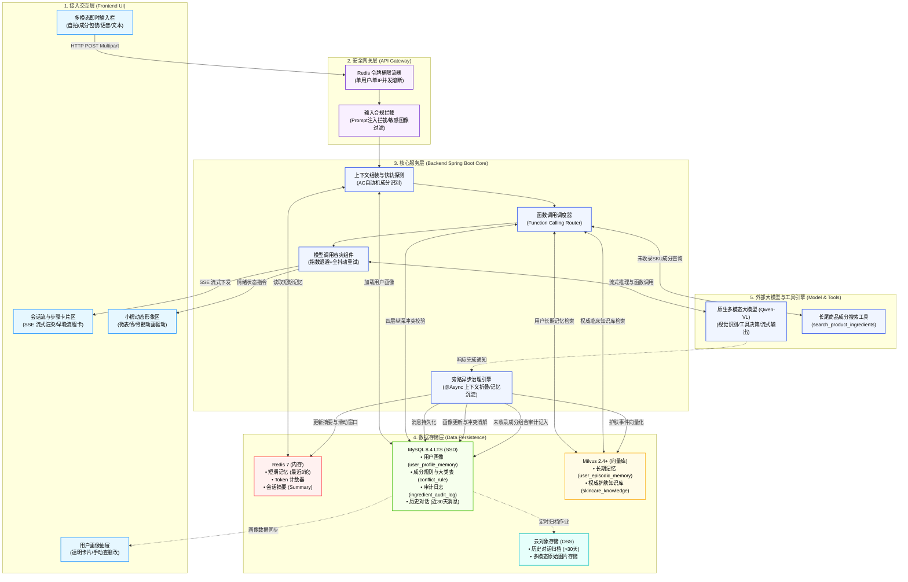
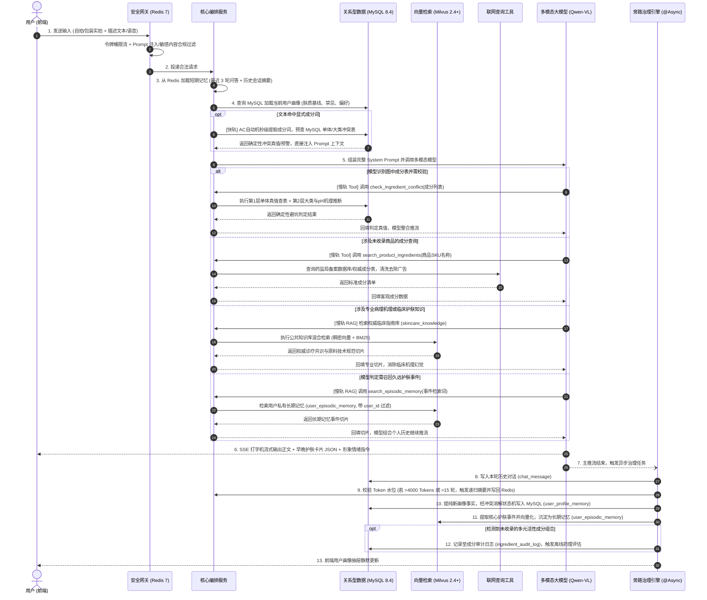
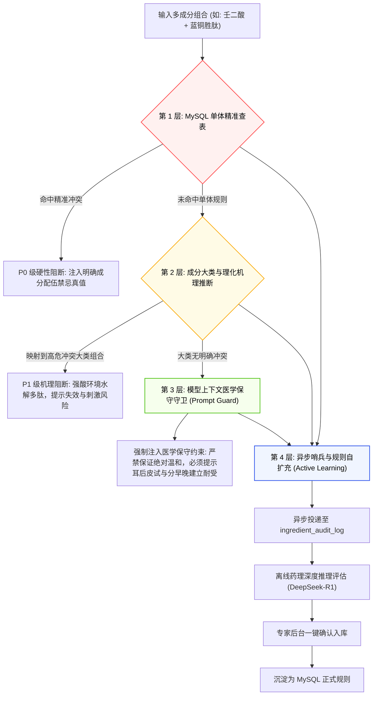

# 小糯智肤 (Nuonuo Skin AI)

> 基于 Spring Boot 3 与 Qwen-VL 的功效护肤 Agent 服务：深度协同原生多模态感知、确定性 Tool Calling 规则拦截、临床指南 RAG 与多层记忆机制。

[-ED8B00?style=flat-square&logo=openjdk&logoColor=white)](#)
[](#)
[](#)
[-4479A1?style=flat-square&logo=mysql&logoColor=white)](#)
[](#)
[](#)
[](#)

---

## 目录
- [业务背景与产品理念](#业务背景与产品理念)
- [系统边界与非目标](#系统边界与非目标)
- [界面交互拓扑](#界面交互拓扑)
- [系统整体架构拓扑](#系统整体架构拓扑)
- [端到端核心处理链路](#端到端核心处理链路)
- [核心架构与工程机制](#核心架构与工程机制)
  - [四层成分配伍禁忌纵深防御体系](#四层成分配伍禁忌纵深防御体系)
  - [双轨专业知识供给体系](#双轨专业知识供给体系)
  - [双阈值上下文动态压缩机制](#双阈值上下文动态压缩机制)
  - [动态推理热度矩阵](#动态推理热度矩阵)
  - [模型调用容灾与指数全抖动](#模型调用容灾与指数全抖动)
- [数据存储设计与架构选型](#数据存储设计与架构选型)
  - [四级持久化选型矩阵](#四级持久化选型矩阵)
  - [MySQL 核心表设计与职责划分](#mysql-核心表设计与职责划分)
  - [Milvus 双集合物理隔离设计](#milvus-双集合物理隔离设计)
- [工程目录结构](#工程目录结构)
- [环境基线与配置字典](#环境基线与配置字典)
- [本地构建与快速开始](#本地构建与快速开始)
- [质量门禁与验收指标](#质量门禁与验收指标)
- [核心设计文档索引](#核心设计文档索引)
- [开源许可证与健康免责声明](#开源许可证与健康免责声明)

---

## 业务背景与产品理念

随着“早C晚A”、“高浓度刷酸”等功效护肤理念的普及，普通消费者盲目叠用强活性成分导致皮肤屏障急性受损、接触性皮炎的案例激增。传统护肤软件普遍存在两大工程与产品缺陷：
1. **导购与填表化陷阱**：要么充斥着强行推销大套盒的电商带货逻辑，要么要求用户填满数十道生硬的测评问卷，会话结束后毫无记忆留存；
2. **大模型成分冲突幻觉**：直接依赖通用大模型自由生成配伍建议，常因概率推断错误将“水杨酸与视黄醇”、“酸类与蓝铜胜肽”等高危冲突判定为温和可同用，造成真实烂脸事故。

**小糯智肤（nuonuo-agent）** 确立了面向真实工程落地的产品哲学：
- **自适应伴随式成长**：去除繁重问卷，在日常随聊与随手拍照中自然提纯用户画像（耐受度、禁忌、偏好），形成越用越懂你的长效专属档案；
- **零机械打卡与零骚扰**：不设定时弹窗与打卡考勤任务，全天候随叫随到，主打温和倾听与情绪共鸣；
- **原生多模态直接感知**：淘汰传统的 OpenCV / MediaPipe 繁琐小模型微服务，由多模态大模型直接感知自拍病理表征与护肤品外包装成分表；
- **确定性规则底线（Grounding）**：成分冲突与配伍禁忌由代码级规则引擎 100% 物理阻断，大模型严禁盲猜化学反应；
- **透明记忆掌控权**：系统提供“用户画像抽屉”，AI 提纯沉淀的所有属性对用户完全透明，支持单条随时查阅、修正或一键删除。

---

## 系统边界与非目标

为确保工程系统极致轻量并规避合规风险，项目明确界定以下非目标（Non-Goals）：
- **不接入实物交易履约**：本系统不设购物车、订单结算、库存锁定与物流追踪链路，彻底剥离电商包袱；
- **不替代执业医师诊断**：系统建议严格限定为居家日常护理指导。当识别到急性严重化脓、大面积脱屑或重度过敏时，系统强制触发就医兜底话术；
- **不维护独立的传统 CV/OCR 微服务**：视觉感知完全收敛至原生多模态大模型输入流，降低微服务运维拓扑复杂度；
- **不设置独立的意图识别微服务**：废弃前置大模型意图分类调用，采用本地 AC 自动机词典扫描结合模型原生函数调用（Function Calling）。

---

## 界面交互拓扑

前端交互界面保持极简与纯粹，围绕 4 个核心功能区块展开：

```
┌────────────────────────────────────────────────────────┐
│  [⚙️ 小糯记住了我]         小糯智肤 (Nuonuo)            │
├────────────────────────────────────────────────────────┤
│                                                        │
│       ( ◕‿◕ )  【小糯动态 IP 形象区】                  │
│      / 🌸  \   • 情绪骨骼动画: 呼吸 / 微动 / 关切 / 欢喜│
│      "宝子，今天脸蛋摸起来舒服一点了吗？"                │
│                                                        │
├────────────────────────────────────────────────────────┤
│  【多轮会话流与步骤卡片区】                             │
│  • SSE 毫秒级首字推流，像打字机一样温软浮现             │
│  • 自动折叠渲染结构化的护肤步骤便签                    │
├────────────────────────────────────────────────────────┤
│  【多模态即时输入栏】                                   │
│  [ 📷 拍自拍/拍梳妆台 ]  [ 🎙️ 语音输入 ]  [ 💬 文字输入... ]│
└────────────────────────────────────────────────────────┘
```

1. **小糯动态 IP 形象区**：情绪载体，根据后端返回的微表情指令联动骨骼动画；
2. **会话流与卡片区**：流式推送自然温和的话术，复杂方案自动解析为结构化晨晚步骤便签；
3. **多模态即时输入栏**：支持面部特写自拍、瓶身成分实拍、语音及自然文本即时输入；
4. **用户画像抽屉（小糯记住了我）**：右上角滑出，直观展示已沉淀的肤质属性与禁忌，支持单条手动删除或编辑。

---

## 系统整体架构拓扑

系统自上而下划分为接入交互层、安全网关层、核心编排层、持久化存储层与外部引擎层：



---

## 端到端核心处理链路

主链路严格保证**主推流路径毫秒级响应，繁重计算与数据沉淀旁路异步化**：



---

## 核心架构与工程机制

### 四层成分配伍禁忌纵深防御体系

面对规则库冷启动期存在盲区、配方冲突无法一次性完全穷举的行业难题，系统构建四层纵深防御体系：



1. **第 1 层（单体精准查表）**：AC 自动机提取具体成分实体，查询 MySQL `ingredient_conflict_rule`（P0 级 100% 硬阻断），大模型无权推翻；
2. **第 2 层（成分大类与理化机理推断）**：通过 `ingredient_dict` 识别成分化学大类（强酸类、金属多肽类、A醇类等）及适宜起效 pH 区间。即使未显式录入“壬二酸 + 蓝铜胜肽”，也能根据“强酸破坏金属螯合键导致多肽变性水解”触发 P1 级机理阻断；
3. **第 3 层（模型上下文医学保守守卫）**：若组合包含两种以上高活性成分且前两层未录入，强制在 Prompt 注入保守守卫指令，严禁宣称绝对安全，必须提示耳后皮试与分早晚建立耐受；
4. **第 4 层（异步哨兵与规则自扩充）**：未收录的高活性组合异步记录至 `ingredient_audit_log`，由离线药理模型推导评估后供药剂专家在后台一键确认为正式规则。

---

### 双轨专业知识供给体系

| 评估维度 | 轨 1: 本地权威临床知识库 (Milvus RAG) | 轨 2: 定向长尾商品成分搜索 (Function Calling) |
| :--- | :--- | :--- |
| **知识定位** | 皮肤病理、生理机制、痤疮分级、临床指南共识 | 市售具体品牌商品（SKU）的最新备案成分表 |
| **底层存储** | Milvus `skincare_knowledge` 集合 | 实时爬取国家药监局化妆品备案库 / 官方成分库 |
| **检索方式** | 稠密向量 (BGE-M3) + 稀疏检索 (BM25) + RRF 融合 | 模型按需触发 `search_product_ingredients` 工具 |
| **防污染机制** | 100% 来源临床文献，天然杜绝公网推销广告与伪科学 | 抓取后经结构化提取器剥离营销文案，仅保留 INCI 列表 |
| **响应耗时** | $\le 50\text{ms}$，完全不拖慢 SSE 首字推流速度 | 按需触发，耗时 $1.5\text{s} \sim 2.5\text{s}$，仅在查未收录产品时调用 |

---

### 双阈值上下文动态压缩机制

针对单轮长文本与多轮碎短句引起的上下文爆炸问题，系统执行**Token 水位主控 + 轮数安全兜底**双阈值策略：
```
当前活跃会话状态
  ├── 最新 3 轮问答 (约 6 条消息) ── 绝对保留，禁止压缩，确保语义连贯
  └── 3 轮之前的较早历史记录
        ├── 检查触发条件: 当前有效 Tokens > 4000 OR 有效轮数 > 15 轮
        └── 满足任一条件: 异步提取历史记录，送入小模型浓缩为 ≤ 200 字摘要并持久化至 Redis
```
- 上下文最终装配公式：
  $$\text{Final Context} = [\text{System Prompt (人设+画像)}] + [\text{Context\_Summary}] + [\text{Recent 3 Turns}]$$

---

### 动态推理热度矩阵

| 交互场景 | 目标业务结果 | 推荐 Temperature 配置 | 选型依据 |
| :--- | :--- | :--- | :--- |
| **成分冲突与配伍禁忌校验** | 确定性布尔值判断与避坑规则判定 | $T = 0.0$ | 必须绝对精准，杜绝配方安全常识的概率发散 |
| **早晚极简护肤卡片生成** | 步骤清晰、严谨按序执行的晨晚流程 | $T = 0.3$ | 保证流程逻辑规范，格式稳定符合 JSON 约束 |
| **日常沟通与情绪共情** | 自然温和、如老友般的倾听与安慰 | $T = 0.65 \sim 0.75$ | 赋予小糯灵动自然的人设陪伴感，避免回答僵硬 |

---

### 模型调用容灾与指数全抖动

面对多模态大模型偶发的网络抖动或 429 限流，采用全抖动（Full Jitter）退避算法，避免重试风暴击穿服务端：
$$t_{\text{wait}} = \text{random}\left(0, \, \min\left(T_{\max}, \, T_{\text{base}} \times 2^{\text{attempt}}\right)\right)$$
* 基准退避时长 $T_{\text{base}} = 1000\text{ms}$；最大退避上限 $T_{\max} = 8000\text{ms}$；最大重试次数 $N = 3$。

---

## 数据存储设计与架构选型

### 四级持久化选型矩阵

| 存储组件 | 物理介质 | 存储内容 | 核心职责 | 数据生命周期 |
| :--- | :--- | :--- | :--- | :--- |
| **Redis 7** | 内存 | • 当前会话 Token 计数<br/>• 最近 3 轮问答<br/>• 当前会话压缩摘要 | 支撑毫秒级流式首字下发，隔离高频读写对数据库的冲击 | 会话级 TTL（24 小时无交互自动失效） |
| **MySQL 8.4 LTS** | SSD 磁盘 | • 用户画像 (`user_profile_memory`)<br/>• 成分大类与标准字典 (`ingredient_dict`)<br/>• 成分配伍规则 (`ingredient_conflict_rule`)<br/>• 未收录成分审计日志 (`ingredient_audit_log`)<br/>• 0 ~ 30 天历史对话 (`chat_message`) | 支撑核心强事务、画像 CRUD 及配方安全真值底座，支撑 Active Learning 规则扩充 | 画像永久有效；历史对话保留 30 天 |
| **Milvus 2.4+** | 内存 + 磁盘 | • 个人长期记忆 (`user_episodic_memory`)<br/>• 权威护肤知识库 (`skincare_knowledge`) | 支撑跨周期事件模糊回忆（带租户隔离），以及专业临床指南语义检索（系统全局共享） | 永久有效（随系统与用户生命周期保留） |
| **云对象存储 (OSS)** | 冷归档存储 | • 超过 30 天的历史对话归档文件<br/>• 用户上传的多模态原始素材 | 压缩存储海量历史会话，控制数据库体量与运维成本 | 归档文件长期归档保存 |

---

### MySQL 核心表设计与职责划分

1. **`user_profile_memory`（用户画像表）**：记录用户经多轮提纯后的稳定属性（肤质、耐受级别、过敏源、偏好），单行键值存储，包含状态与版本迭代控制；
2. **`ingredient_dict`（成分标准字典表）**：与 INCI 标准名称对齐，记录标准中文名、别名、所属化学大类（`HIGH_ACID`、`RETINOIDS`、`METAL_PEPTIDE` 等）与起效 pH 区间；
3. **`ingredient_conflict_rule`（成分配伍禁忌规则表）**：支持具体单体（`SINGLE`）与化学大类（`CATEGORY`）两级规则，定义严禁搭配（`STRICT_FORBIDDEN`）与谨慎搭配（`CAUTION`）；
4. **`ingredient_audit_log`（成分审计与规则自扩充日志表）**：持久化记录未命中前置规则的多元强活性成分组合，驱动 Active Learning 离线审核闭环；
5. **`chat_message`（历史会话消息表）**：支撑近 30 天在线漫游，记录结构化卡片载荷、多模态素材 URL 与估算 Token 消耗。

---

### Milvus 双集合物理隔离设计

- **集合一：`user_episodic_memory`（用户个人长期记忆）**：带有 `user_id` 强租户隔离字段，HNSW 索引，存储用户过往的严重皮肤事件（晒伤脱皮、严重爆痘、不耐受反应）；
- **集合二：`skincare_knowledge`（权威护肤专业知识库）**：系统全局共享知识库，存储《中国痤疮治疗指南》、《皮肤屏障修护专家共识》等结构化四元组切片，无租户隔离限制。

---

## 工程目录结构

```
nuonuo-agent/
├── .env.example                               # 环境变量与配置字典模版
├── .gitignore                                 # Git 忽略规则
├── AGENTS.md                                  # 项目协作与 Agent 提交治理规范 (含时间戳偏移规则)
├── README.md                                  # 项目技术主页
└── docs/                                      # 核心工程设计文档体系
    ├── 01_需求分析与业务闭环设计.md             # 需求拆解与伴随式成长模型
    ├── 02_小糯IP人设与品牌交互规范.md           # 白桃雪媚娘 IP 交互与情感约束
    ├── 03_系统架构与技术落地方案.md             # 端到端链路、数据结构与接口标准
    └── architecture/                          # 研发规范与工程准则
```

---

## 环境基线与配置字典

### 基础环境要求
- **Java Runtime**：JDK 17 LTS (Amazon Corretto / Eclipse Temurin)
- **Framework**：Spring Boot 3.3.5 / Spring AI Alibaba 1.0.0.2
- **Database**：MySQL 8.4 LTS / Redis 7+ / Milvus 2.4+
- **Build Tool**：Apache Maven 3.9+

### 核心环境变量配置表（对应 `.env.example`）

| 环境变量名 | 说明 | 示例值 | 是否必填 |
| :--- | :--- | :--- | :---: |
| `SERVER_PORT` | 服务监听端口 | `8080` | 否 |
| `SPRING_DATASOURCE_URL` | MySQL 连接串 | `jdbc:mysql://127.0.0.1:3306/nuonuo_agent` | **是** |
| `SPRING_DATASOURCE_USERNAME` | MySQL 用户名 | `nuonuo_root` | **是** |
| `SPRING_DATASOURCE_PASSWORD` | MySQL 密码 | `YourSecurePassword` | **是** |
| `SPRING_DATA_REDIS_HOST` | Redis 主机地址 | `127.0.0.1` | **是** |
| `SPRING_DATA_REDIS_PORT` | Redis 端口 | `6379` | 否 |
| `MILVUS_HOST` | Milvus 向量库主机 | `127.0.0.1` | **是** |
| `MILVUS_PORT` | Milvus 端口 | `19530` | 否 |
| `AI_DASHSCOPE_API_KEY` | 阿里灵积 Qwen-VL API Key | `sk-xxxxxxxxxxxxxxxx` | **是** |
| `AI_DASHSCOPE_MODEL` | 多模态大模型型号 | `qwen-vl-max` | 否 |
| `OSS_ENDPOINT` | 阿里云对象存储端点 | `oss-cn-hangzhou.aliyuncs.com` | **是** |
| `OSS_BUCKET_NAME` | 存储桶名称 | `nuonuo-agent-storage` | **是** |

---

## 本地构建与快速开始

### 1. 克隆代码与配置初始化
```bash
git clone https://github.com/happypig1224/nuonuo-agent.git
cd nuonuo-agent
cp .env.example .env
```

### 2. 初始化数据库结构
在本地 MySQL 8.4 实例中执行 `docs/03_系统架构与技术落地方案.md` 第 4.2 节中的 DDL 脚本，初始化字典表与规则底座。

### 3. 本地编译与运行
```bash
# 编译并执行单元测试
mvn clean package -DskipTests=false

# 启动 Spring Boot 应用
mvn spring-boot:run
```

### 4. 服务健康检查与流式会话验证
```bash
# 流式推流端点验证 (SSE)
curl -N -X POST http://localhost:8080/api/v1/chat/completions/stream \
  -F "prompt=今天额头冒了两颗红肿痘痘，手头有壬二酸和B5乳霜，应该怎么搭配？"
```

---

## 质量门禁与验收指标

1. **响应时延（TTFT）**：在常规 4G/WiFi 网络下，首字流式输出时间（TTFT）P95 稳定在 800ms 以内；
2. **配伍禁忌确定性**：针对高浓度酸类与视黄醇叠加、强氧化剂与蓝铜胜肽叠加场景，规则拦截命中率 100%，无一例诱导翻车；
3. **纵深防御兜底**：未收录在单体表中的酸类与多肽/A醇冷启动组合，第 2 层大类推断与第 3 层医学保守守卫触发率 100%，第 4 层审计日志写入率 100%；
4. **知识防污染**：涉及皮肤病理机理与诊疗指南咨询时，本地临床知识库 RAG 召回命中率大于 90%，严禁引入公网未经脱敏的营销软文；
5. **上下文稳定性**：持续进行 20 轮连续对话，单会话总 Token 开销平稳维持在 4000 Tokens 水位线以内，摘要完整保留历史核心事实；
6. **画像透明可控**：在用户画像抽屉中删除某项记忆后，后续问答即时生效，不再携带已删除画像。

---

## 核心设计文档索引

| 序号 | 规范文档 | 物理路径 | 核心覆盖维度 |
| :---: | :--- | :--- | :--- |
| **01** | **需求分析与业务闭环设计** | [docs/01_需求分析与业务闭环设计.md](docs/01_需求分析与业务闭环设计.md) | 用户痛点剖析、伴随式成长模型、日常高频场景与极简界面规范 |
| **02** | **小糯 IP 人设与品牌交互规范** | [docs/02_小糯IP人设与品牌交互规范.md](docs/02_小糯IP人设与品牌交互规范.md) | 白桃雪媚娘视觉定义、用语禁区、提示词工程与老友共情范式 |
| **03** | **系统架构与技术落地方案** | [docs/03_系统架构与技术落地方案.md](docs/03_系统架构与技术落地方案.md) | 端到端 7 级流水线、四层成分冲突防御、Milvus 双集合设计与 SSE 规范 |
| **04** | **协作准则与提交治理规范** | [AGENTS.md](AGENTS.md) | Git 提交时间戳偏移规则、阿里巴巴规范与去 AI 味代码治理准则 |

---

## 开源许可证与健康免责声明

- 本项目代码遵循 **MIT 开源许可证**；
- **健康与医疗免责声明**：本项目所生成的护肤指导方案仅供日常护肤与个护参考，不构成医疗处方与临床诊断建议。若出现急性皮肤病变、严重化脓性感染、大面积红肿刺痛或严重接触性皮炎，请立即前往正规医院皮肤科就医。
