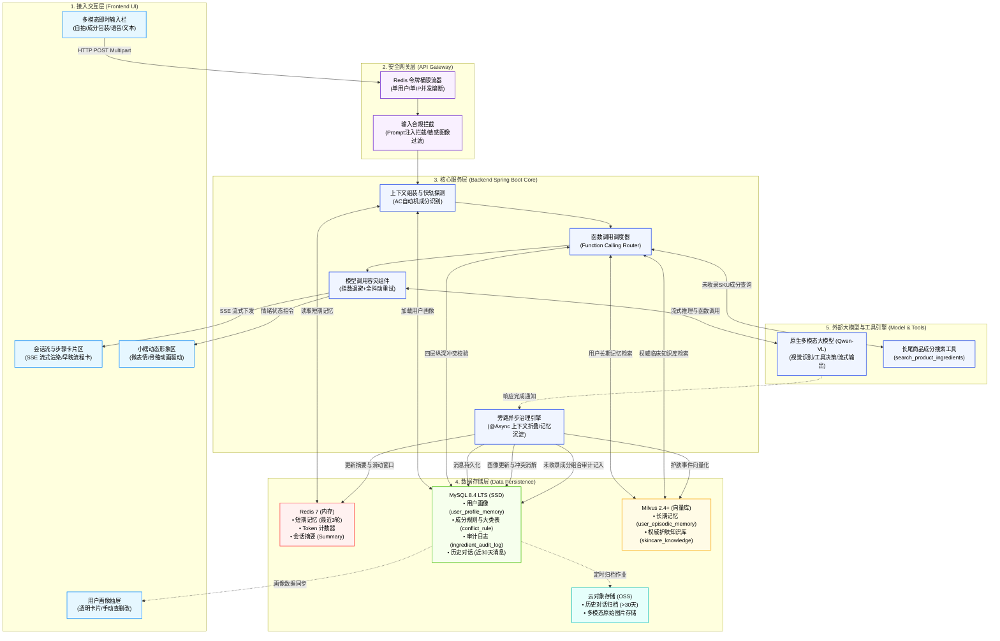
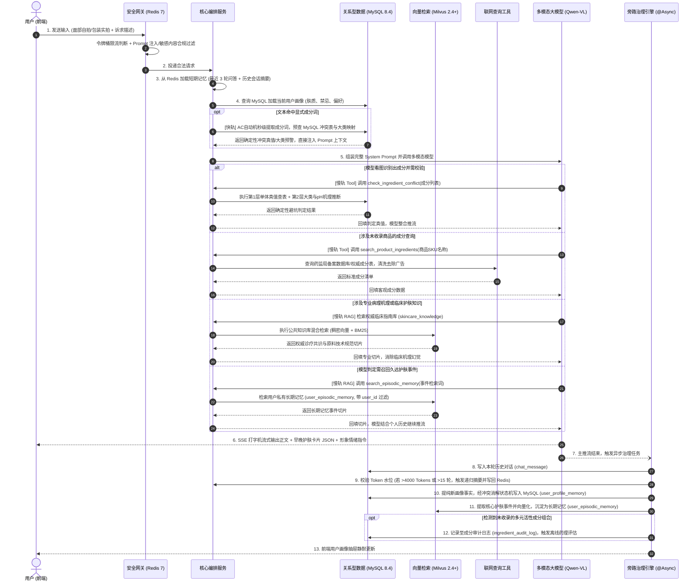
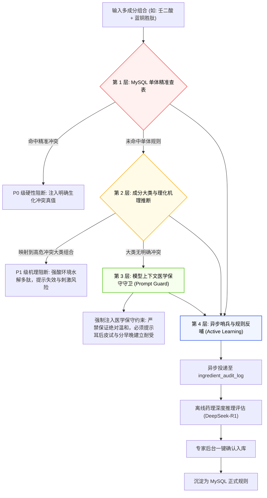

# 小糯智肤系统架构与技术落地方案

本文档定义小糯智肤（nuonuo-agent）工程系统的整体技术架构、端到端处理链路、数据存储设计与核心工程治理机制，作为系统研发、测试与投产交付的技术标准。

---

## 1. 系统设计目标与边界

### 1.1 核心设计指标
- **首字响应延迟（TTFT）**：主链路采用 Server-Sent Events（SSE）流式打字推流，首字下发耗时控制在 800ms 以内。
- **生化避坑确定性**：成分配伍禁忌判定执行代码级真值校验，杜绝大语言模型在护肤生化常识上的随机幻觉。
- **长效自适应记忆**：通过用户画像与长期记忆双轨机制，实现跨会话的护肤档案继承与历史事件回忆。
- **高可用重试容灾**：外部大模型调用集成指数退避与全抖动重试机制，平滑抵御偶发超时与 429 限流。

### 1.2 系统边界（Non-Goals）
- **不接入交易履约系统**：本系统聚焦护肤咨询、多模态测肤与成分避坑陪伴，不包含购物车、订单支付、库存锁定及物流履约模块。
- **不搭建强行打卡延时队列**：放弃按天定周期唤醒用户的重型定时机制，转为由用户自主发起的多模态伴随式交互。
- **不维护独立的传统 CV/OCR 微服务**：摒弃 OpenCV、MediaPipe 等传统图像处理微服务，全面依托原生多模态大模型的视觉理解能力。
- **不设置独立的意图识别微服务**：废弃前置大模型意图分类节点，消除多余网络跳转，采用本地词典极速探测结合模型原生函数调用（Function Calling）。

---

## 2. 系统整体架构拓扑

系统自上而下划分为接入交互层、安全网关层、核心服务层、数据存储层与底层模型引擎。



---

## 3. 端到端核心处理链路

系统主链路遵循“主响应极致轻量、耗时任务旁路异步化”原则，划分为 7 个执行阶段。



### 3.1 Stage 1: 多模态素材上传与输入封装
- 用户端支持面部特写自拍、瓶身成分包装实拍，辅以语音或文本描述。
- 图像数据由客户端上传至云存储后生成预签名临时访问 URL，避免大文件直接穿透业务网关。

### 3.2 Stage 2: 确定性安全网关
- **高频限流**：基于 Redis 令牌桶算法，设置单用户单 IP 限流策略，防止大图并发轰炸。
- **输入合规拦截**：
  - 针对文本内容进行越狱提示词与敏感注入拦截。
  - 针对图像调用安全审查接口，非合规图像在网关层秒级拦截，不进入后端模型算力调度。

### 3.3 Stage 3: 上下文装载与本地快轨探测
- **短期记忆装载（Redis）**：
  从 Redis 读取当前会话状态，包括当前会话的累积 Token 计数、最近 3 轮完整问答以及前置生成的会话摘要（`Context_Summary`），查询耗时小于 2ms。
- **用户画像装载（MySQL）**：
  从 MySQL `user_profile_memory` 单表索引读取该用户所有处于激活态（`status = 'ACTIVE'`）的画像记录，包括肤质基线、成分禁忌和偏好。单表扫描耗时小于 1ms，确保 100% 确定性全量装载进上下文。
- **本地避坑快轨（0ms 外部开销）**：
  利用 Aho-Corasick（AC 自动机）算法扫描用户文本中的成分实体。若直接命中成分配伍禁忌规则或大类冲突，在调用大模型前预先完成 MySQL 冲突校验，将避坑判定结果以静态真值形式注入 Prompt，省去模型二次函数调用的网络往返。

### 3.4 Stage 4: 原生多模态模型流式推理与慢轨自适应调度
- **模型驱动的慢轨工具集**：
  - **成分冲突校验工具（`check_ingredient_conflict`）**：若用户上传包装瓶实拍图，模型识别图中成分表后自主触发，后端执行第 1 层单体精准查表与第 2 层大类机理推断后回填真值。
  - **长尾商品成分查询工具（`search_product_ingredients`）**：当用户询问具体市售商品且本地未收录配方时触发，定向检索药监局备案库，严密清洗剔除广告营销软文。
  - **权威临床知识库检索（`skincare_knowledge`）**：涉及皮肤病理、痤疮分级、敏感肌屏障修复等机制咨询时，由 Spring AI Advisor 自动在 Milvus 公共知识库中执行混合检索，将临床共识切片注入上下文，杜绝伪科学与机理幻觉。
  - **个人长期记忆检索（`search_episodic_memory`）**：若用户询问跨周期的历史护肤事件（例如“上次去海边暴晒脸发红用的什么精华”），模型触发该工具，检索 Milvus 私有集合获取历史切片。
- **高可用重试保障**：模型调用集成指数退避与全抖动重试，防止突发网络抖动导致推流中断。
- **流式输出**：通过 SSE 逐字向前端推送内容，首字下发延迟压制在 800ms 内。

### 3.5 Stage 5: 前端多维流式渲染
- 前端打字机流式展示文本回复。
- 若包含早晚护肤建议，解析模型返回的结构化 JSON 块，渲染为独立的早晚护肤流程卡片。
- 解析消息中的情绪状态指令（如 `[EMOTION: CONCERNED]`），触发前端 IP 形象的骨骼动画联动。

### 3.6 Stage 6: 旁路异步上下文治理（@Async）
主响应推流结束后，线程池异步接管后续处理，不占用用户响应耗时：
1. **历史对话持久化**：将当轮问答写入 MySQL `chat_message` 表。
2. **Token 水位校验与压缩**：
   - 累加计算当前会话总有效 Token 数。
   - 触发条件：当前会话有效 Token 超过 4000 或有效轮数超过 15 轮。
   - 压缩策略：保持最新 3 轮问答完整不变，将 3 轮之前的较早历史记录送入轻量模型浓缩为 200 字以内的会话摘要（`Context_Summary`），并回写至 Redis。
3. **用户画像提纯与状态机冲突消解**：
   - 分析当轮对话提纯新增生理事实（如“昨晚使用视黄醇后眼周刺痛”）。
   - 走状态机冲突消解逻辑：若与旧画像属性冲突，废弃旧记录，生成递增版本的新画像记录并写入 MySQL。
4. **长期记忆向量化沉淀**：
   - 提纯具备长期参考价值的护肤事件（带时间、症状及处置结果），生成向量嵌入写入 Milvus `user_episodic_memory`。
5. **未收录成分审计与反哺**：
   - 监测到多活性成分组合但未命中规则库时，异步记录至 MySQL `ingredient_audit_log`，供离线评估与规则扩充。

### 3.7 Stage 7: 历史会话定时冷热分离归档
- **执行机制**：每日凌晨执行定时归档批处理任务。
- **归档范围**：扫描 MySQL 中创建时间早于 30 天且已完结的会话。
- **归档操作**：将历史对话记录批量打包并压缩为 Gzip 格式的 JSONL 文件，上传至对象存储（OSS/S3）的低频冷归档存储空间。
- **清理与保留**：归档完成后清理 MySQL `chat_message` 中的单条明细，仅保留轻量级会话索引（记录时间、消息总数和归档下载路径）。
- **核心约束**：历史对话消息可随时间归档至冷存储，但提纯后的用户画像与长期记忆必须终生在线保存。

---

## 4. 数据存储设计与架构选型

### 4.1 存储选型矩阵

| 存储组件 | 物理介质 | 存储内容 | 核心职责 | 数据生命周期 |
| :--- | :--- | :--- | :--- | :--- |
| **Redis 7** | 内存 | • 当前会话 Token 计数<br/>• 最近 3 轮问答<br/>• 当前会话压缩摘要 | 支撑毫秒级流式首字下发，隔离高频读写对数据库的冲击 | 会话级 TTL（24 小时无交互自动失效） |
| **MySQL 8.4 LTS** | SSD 磁盘 | • 用户画像 (`user_profile_memory`)<br/>• 成分大类与标准字典 (`ingredient_dict`)<br/>• 成分配伍规则 (`ingredient_conflict_rule`)<br/>• 未收录成分审计日志 (`ingredient_audit_log`)<br/>• 0 ~ 30 天历史对话 (`chat_message`) | 支撑核心强事务、画像 CRUD 及生化安全真值底座，支撑 Active Learning 规则扩充 | 画像永久有效；历史对话保留 30 天 |
| **Milvus 2.4+** | 内存 + 磁盘 | • 个人长期记忆 (`user_episodic_memory`)<br/>• 权威护肤知识库 (`skincare_knowledge`) | 支撑跨周期事件模糊回忆（带租户隔离），以及专业临床指南语义检索（系统全局共享） | 永久有效（随系统与用户生命周期保留） |
| **云对象存储 (OSS)** | 冷归档存储 | • 超过 30 天的历史对话归档文件<br/>• 用户上传的多模态原始素材 | 压缩存储海量历史会话，控制数据库体量与运维成本 | 归档文件长期归档保存 |

---

### 4.2 MySQL 8.4 表结构设计 (DDL)

```sql
-- 1. 用户基础信息表
CREATE TABLE IF NOT EXISTS `user_account` (
    `id` BIGINT UNSIGNED NOT NULL AUTO_INCREMENT COMMENT '主键ID',
    `user_id` VARCHAR(64) NOT NULL COMMENT '用户业务唯一标识',
    `nickname` VARCHAR(64) NOT NULL DEFAULT '' COMMENT '用户昵称',
    `created_at` DATETIME NOT NULL DEFAULT CURRENT_TIMESTAMP COMMENT '注册时间',
    `updated_at` DATETIME NOT NULL DEFAULT CURRENT_TIMESTAMP ON UPDATE CURRENT_TIMESTAMP COMMENT '更新时间',
    PRIMARY KEY (`id`),
    UNIQUE KEY `uk_user_id` (`user_id`)
) ENGINE=InnoDB DEFAULT CHARSET=utf8mb4 COLLATE=utf8mb4_bin COMMENT='用户基础信息表';

-- 2. 用户画像表 (取代模糊概念，单行强类型+版本状态机)
CREATE TABLE IF NOT EXISTS `user_profile_memory` (
    `id` BIGINT UNSIGNED NOT NULL AUTO_INCREMENT COMMENT '主键ID',
    `user_id` VARCHAR(64) NOT NULL COMMENT '所属用户业务ID',
    `category` VARCHAR(32) NOT NULL COMMENT '画像类别: SKIN_TYPE(肤质), ALLERGY(禁忌过敏), PREFERENCE(偏好)',
    `profile_key` VARCHAR(64) NOT NULL COMMENT '画像项标识: 如 alcohol, retinol, skin_base',
    `profile_value` VARCHAR(255) NOT NULL COMMENT '画像值: 如 重度接触性泛红, 干性敏感肌',
    `confidence` DECIMAL(3, 2) NOT NULL DEFAULT 1.00 COMMENT '置信度 (0.00 ~ 1.00)',
    `status` VARCHAR(16) NOT NULL DEFAULT 'ACTIVE' COMMENT '状态: ACTIVE(生效), DEPRECATED(已废弃)',
    `version` INT UNSIGNED NOT NULL DEFAULT 1 COMMENT '版本号(用于冲突更新版本迭代)',
    `source_session_id` VARCHAR(64) DEFAULT NULL COMMENT '来源会话ID',
    `created_at` DATETIME NOT NULL DEFAULT CURRENT_TIMESTAMP COMMENT '创建时间',
    `updated_at` DATETIME NOT NULL DEFAULT CURRENT_TIMESTAMP ON UPDATE CURRENT_TIMESTAMP COMMENT '更新时间',
    PRIMARY KEY (`id`),
    KEY `idx_user_status` (`user_id`, `status`),
    KEY `idx_user_key` (`user_id`, `profile_key`)
) ENGINE=InnoDB DEFAULT CHARSET=utf8mb4 COLLATE=utf8mb4_bin COMMENT='用户画像表';

-- 3. 成分标准字典表 (INCI 权威对齐 + 生化大类与pH属性)
CREATE TABLE IF NOT EXISTS `ingredient_dict` (
    `id` BIGINT UNSIGNED NOT NULL AUTO_INCREMENT COMMENT '主键ID',
    `inci_name_cn` VARCHAR(128) NOT NULL COMMENT '中文标准名称',
    `inci_name_en` VARCHAR(128) NOT NULL DEFAULT '' COMMENT '英文标准名称',
    `alias_names` JSON DEFAULT NULL COMMENT '常见别名/商品名列表 (JSON 数组)',
    `category` VARCHAR(32) NOT NULL DEFAULT 'OTHER' COMMENT '生化大类: HIGH_ACID(强酸), RETINOIDS(A醇类), METAL_PEPTIDE(金属多肽), PURE_VC(原型维C), NIACINAMIDE(烟酰胺), GENTLE_HYDRATOR(温和保湿)',
    `ph_min` DECIMAL(3, 1) DEFAULT NULL COMMENT '适宜起效最低pH',
    `ph_max` DECIMAL(3, 1) DEFAULT NULL COMMENT '适宜起效最高pH',
    `irritancy_level` TINYINT UNSIGNED NOT NULL DEFAULT 0 COMMENT '刺激度等级 (0:温和, 1:轻度, 2:强刺激)',
    `is_preservative` TINYINT(1) NOT NULL DEFAULT 0 COMMENT '是否为防腐剂',
    `is_sensitizer` TINYINT(1) NOT NULL DEFAULT 0 COMMENT '是否为常见致敏原',
    `created_at` DATETIME NOT NULL DEFAULT CURRENT_TIMESTAMP COMMENT '创建时间',
    PRIMARY KEY (`id`),
    UNIQUE KEY `uk_inci_cn` (`inci_name_cn`),
    KEY `idx_inci_en` (`inci_name_en`),
    KEY `idx_category` (`category`)
) ENGINE=InnoDB DEFAULT CHARSET=utf8mb4 COLLATE=utf8mb4_bin COMMENT='成分标准字典表';

-- 4. 成分配伍禁忌规则表 (支持具体单体与大类机理两级规则)
CREATE TABLE IF NOT EXISTS `ingredient_conflict_rule` (
    `id` BIGINT UNSIGNED NOT NULL AUTO_INCREMENT COMMENT '主键ID',
    `rule_level` VARCHAR(16) NOT NULL DEFAULT 'SINGLE' COMMENT '规则级别: SINGLE(单体精准对), CATEGORY(大类理化冲突)',
    `ingredient_a` VARCHAR(128) DEFAULT NULL COMMENT '源成分名称 (当 rule_level=SINGLE 时有效)',
    `ingredient_b` VARCHAR(128) DEFAULT NULL COMMENT '冲突成分名称 (当 rule_level=SINGLE 时有效)',
    `category_a` VARCHAR(32) DEFAULT NULL COMMENT '源成分大类 (当 rule_level=CATEGORY 时有效)',
    `category_b` VARCHAR(32) DEFAULT NULL COMMENT '冲突成分大类 (当 rule_level=CATEGORY 时有效)',
    `conflict_level` VARCHAR(16) NOT NULL COMMENT '冲突等级: STRICT_FORBIDDEN(严禁同用), CAUTION(谨慎搭配)',
    `risk_mechanism` VARCHAR(255) NOT NULL COMMENT '风险机理 (如: 强酸环境使蓝铜胜肽水解变性并析出游离铜离子引起红斑)',
    `handling_advice` VARCHAR(255) NOT NULL COMMENT '安全处置建议 (如: 建议间隔12小时分早晚使用，或错开生理周期使用)',
    `created_at` DATETIME NOT NULL DEFAULT CURRENT_TIMESTAMP COMMENT '创建时间',
    PRIMARY KEY (`id`),
    KEY `idx_pair` (`ingredient_a`, `ingredient_b`),
    KEY `idx_category_pair` (`category_a`, `category_b`)
) ENGINE=InnoDB DEFAULT CHARSET=utf8mb4 COLLATE=utf8mb4_bin COMMENT='成分配伍禁忌规则表';

-- 5. 未收录成分组合审计日志表 (Active Learning 规则扩充哨兵)
CREATE TABLE IF NOT EXISTS `ingredient_audit_log` (
    `id` BIGINT UNSIGNED NOT NULL AUTO_INCREMENT COMMENT '主键ID',
    `session_id` VARCHAR(64) NOT NULL COMMENT '触发会话ID',
    `user_id` VARCHAR(64) NOT NULL COMMENT '用户业务ID',
    `ingredient_names` JSON NOT NULL COMMENT '提取到的多元活性成分列表 (JSON 数组)',
    `category_tags` JSON DEFAULT NULL COMMENT '解析出的大类标签 (JSON 数组)',
    `audit_status` VARCHAR(16) NOT NULL DEFAULT 'PENDING' COMMENT '状态: PENDING(待评估), REVIEWED(已评估), RULE_CREATED(已入库), IGNORED(无需干预)',
    `suggested_mechanism` TEXT DEFAULT NULL COMMENT '离线药理模型推导评估结论',
    `created_at` DATETIME NOT NULL DEFAULT CURRENT_TIMESTAMP COMMENT '创建时间',
    `updated_at` DATETIME NOT NULL DEFAULT CURRENT_TIMESTAMP ON UPDATE CURRENT_TIMESTAMP COMMENT '更新时间',
    PRIMARY KEY (`id`),
    KEY `idx_status_time` (`audit_status`, `created_at`)
) ENGINE=InnoDB DEFAULT CHARSET=utf8mb4 COLLATE=utf8mb4_bin COMMENT='未收录成分审计与规则自扩充日志表';

-- 6. 会话索引表
CREATE TABLE IF NOT EXISTS `chat_session` (
    `id` BIGINT UNSIGNED NOT NULL AUTO_INCREMENT COMMENT '主键ID',
    `session_id` VARCHAR(64) NOT NULL COMMENT '会话业务唯一ID',
    `user_id` VARCHAR(64) NOT NULL COMMENT '用户业务ID',
    `title` VARCHAR(128) NOT NULL DEFAULT '新护肤咨询' COMMENT '会话标题',
    `status` VARCHAR(16) NOT NULL DEFAULT 'ACTIVE' COMMENT '状态: ACTIVE(活跃), CLOSED(已完结), ARCHIVED(已归档)',
    `total_messages` INT UNSIGNED NOT NULL DEFAULT 0 COMMENT '消息总数',
    `archive_oss_path` VARCHAR(255) DEFAULT NULL COMMENT '冷存储OSS归档路径',
    `created_at` DATETIME NOT NULL DEFAULT CURRENT_TIMESTAMP COMMENT '创建时间',
    `updated_at` DATETIME NOT NULL DEFAULT CURRENT_TIMESTAMP ON UPDATE CURRENT_TIMESTAMP COMMENT '更新时间',
    PRIMARY KEY (`id`),
    UNIQUE KEY `uk_session_id` (`session_id`),
    KEY `idx_user_session` (`user_id`, `created_at`)
) ENGINE=InnoDB DEFAULT CHARSET=utf8mb4 COLLATE=utf8mb4_bin COMMENT='会话索引表';

-- 7. 历史对话消息表 (0 ~ 30 天在线数据)
CREATE TABLE IF NOT EXISTS `chat_message` (
    `id` BIGINT UNSIGNED NOT NULL AUTO_INCREMENT COMMENT '主键ID',
    `message_id` VARCHAR(64) NOT NULL COMMENT '消息业务唯一ID',
    `session_id` VARCHAR(64) NOT NULL COMMENT '所属会话ID',
    `user_id` VARCHAR(64) NOT NULL COMMENT '用户业务ID',
    `role` VARCHAR(16) NOT NULL COMMENT '角色: user, assistant, system, tool',
    `content` TEXT NOT NULL COMMENT '消息正文',
    `structured_card` JSON DEFAULT NULL COMMENT '结构化卡片载荷 (如早晚护肤流程 JSON)',
    `media_urls` JSON DEFAULT NULL COMMENT '关联多模态素材URL列表 (JSON 数组)',
    `token_count` INT UNSIGNED NOT NULL DEFAULT 0 COMMENT '当条消息消耗Token估算值',
    `created_at` DATETIME NOT NULL DEFAULT CURRENT_TIMESTAMP COMMENT '创建时间',
    PRIMARY KEY (`id`),
    UNIQUE KEY `uk_message_id` (`message_id`),
    KEY `idx_session_time` (`session_id`, `created_at`),
    KEY `idx_user_created` (`user_id`, `created_at`)
) ENGINE=InnoDB DEFAULT CHARSET=utf8mb4 COLLATE=utf8mb4_bin COMMENT='历史对话消息表';
```

---

### 4.3 Redis 7 缓存设计

| 缓存键命名规范 | 数据结构 | TTL 过期策略 | 核心用途与值结构 |
| :--- | :--- | :--- | :--- |
| `nuonuo:limiter:{userId}` | String (Counter) | 60 秒自动失效 | 令牌桶限流计数器，控制每分钟调用频率上限 |
| `nuonuo:session:{sessionId}:window` | List | 24 小时滑动过期 | 存储最近 3 轮问答 JSON，结构包含 role, content, mediaUrls |
| `nuonuo:session:{sessionId}:tokens` | String (Integer) | 24 小时滑动过期 | 存储当前活跃会话已消耗的累计有效 Token 数 |
| `nuonuo:session:{sessionId}:summary` | String | 24 小时滑动过期 | 存储当前会话 200 字以内的递归压缩摘要文本 |

---

### 4.4 Milvus 2.4+ 向量集合规范 (Schema)

系统规划两个独立的物理集合，实现**用户私有记忆与系统公用专业知识的严格解耦**：

#### 集合 1: 用户个人长期记忆 (`user_episodic_memory`)
用于沉淀具备医学和经验参考价值的历史事件，带有强租户隔离字段 `user_id`：

```json
{
  "collection_name": "user_episodic_memory",
  "fields": [
    {
      "name": "id",
      "data_type": "Int64",
      "is_primary": true,
      "auto_id": true
    },
    {
      "name": "user_id",
      "data_type": "VarChar",
      "max_length": 64
    },
    {
      "name": "event_type",
      "data_type": "VarChar",
      "max_length": 32,
      "description": "事件类别: SUNBURN(晒伤), ACNE_OUTBREAK(爆痘), PRODUCT_INTOLERANCE(不耐受)"
    },
    {
      "name": "event_summary",
      "data_type": "VarChar",
      "max_length": 512,
      "description": "提纯后的事件文本 (如: 2026年3月三亚海边暴晒面颊发红脱皮，涂抹B5修护后2天缓解)"
    },
    {
      "name": "vector",
      "data_type": "FloatVector",
      "dim": 1024,
      "description": "文本语义嵌入向量 (Text-Embedding-v3 维度)"
    },
    {
      "name": "occurred_at",
      "data_type": "Int64",
      "description": "事件发生时的时间戳 (毫秒)"
    }
  ],
  "indexes": [
    {
      "field_name": "vector",
      "index_type": "HNSW",
      "metric_type": "COSINE",
      "params": { "M": 16, "efConstruction": 200 }
    },
    {
      "field_name": "user_id",
      "index_type": "INVERTED"
    }
  ]
}
```

#### 集合 2: 权威护肤专业知识库 (`skincare_knowledge`)
系统全局公共知识库，汇编临床指南、专家共识与药监局原料技术规范，无租户隔离限制：

```json
{
  "collection_name": "skincare_knowledge",
  "fields": [
    {
      "name": "id",
      "data_type": "Int64",
      "is_primary": true,
      "auto_id": true
    },
    {
      "name": "doc_id",
      "data_type": "VarChar",
      "max_length": 64,
      "description": "来源文档标识 (如: CLINICAL_GUIDE_ACNE_2024)"
    },
    {
      "name": "category",
      "data_type": "VarChar",
      "max_length": 32,
      "description": "知识类别: PATHOLOGY(病理机制), INGREDIENT_EFFICACY(成分机理), BARRIER_REPAIR(屏障修复)"
    },
    {
      "name": "chunk_title",
      "data_type": "VarChar",
      "max_length": 128,
      "description": "切片标题 (如: 痤疮三级丘疹脓疱型外用壬二酸耐受建立机制)"
    },
    {
      "name": "chunk_content",
      "data_type": "VarChar",
      "max_length": 1024,
      "description": "结构化四元组核心切片文本"
    },
    {
      "name": "vector",
      "data_type": "FloatVector",
      "dim": 1024,
      "description": "切片语义嵌入向量 (Text-Embedding-v3 维度)"
    },
    {
      "name": "evidence_source",
      "data_type": "VarChar",
      "max_length": 255,
      "description": "权威医学出处来源"
    }
  ],
  "indexes": [
    {
      "field_name": "vector",
      "index_type": "HNSW",
      "metric_type": "COSINE",
      "params": { "M": 16, "efConstruction": 200 }
    },
    {
      "field_name": "category",
      "index_type": "INVERTED"
    }
  ]
}
```

---

## 5. 核心算法与工程机制落地

### 5.1 上下文双阈值动态压缩算法
为杜绝单轮长输入导致的上下文爆炸及大量短句导致的信息无序，系统严格执行**Token 水位主控 + 轮数安全兜底**的双阈值策略：

```
当前活跃会话状态
  ├── 最新 3 轮问答 (约 6 条消息) ── 绝对保留，禁止压缩，确保语义连贯
  └── 3 轮之前的较早历史记录
        ├── 检查触发条件: 当前有效 Tokens > 4000 OR 有效轮数 > 15 轮
        └── 满足任一条件: 异步提取历史记录，送入小模型浓缩为 ≤ 200 字摘要
```

- **组装公式**：
  $$\text{Final Context} = [\text{System Prompt (人设+画像)}] + [\text{Context\_Summary}] + [\text{Recent 3 Turns}]$$

---

### 5.2 模型调用容灾：指数退避与全抖动重试 (Full Jitter)
面对调用多模态模型时偶发的网络抖动或服务端限流（429 Too Many Requests），采用全抖动算法计算重试等待时长，避免产生重试风暴击穿服务端：

$$t_{\text{wait}} = \text{random}\left(0, \, \min\left(T_{\max}, \, T_{\text{base}} \times 2^{\text{attempt}}\right)\right)$$

- **参数标准配置**：
  - 基准退避时长 $T_{\text{base}} = 1000\text{ms}$
  - 最大退避上限 $T_{\max} = 8000\text{ms}$
  - 最大重试次数 $N = 3$
  - 仅针对连接超时、读取超时及 HTTP 429/502/503/504 错误触发重试，针对用户输入非法（400/401/403）即时熔断。

---

### 5.3 动态热度分层矩阵 (Temperature Matrix)
根据执行场景严格约束模型推理的生成随机度：

| 交互场景 | 目标业务结果 | 推荐 Temperature 配置 | 选型依据 |
| :--- | :--- | :--- | :--- |
| **成分冲突与禁忌校验** | 确定性布尔值判断与避坑规则判定 | $T = 0.0$ | 必须绝对精准，杜绝生化护肤常识的概率发散 |
| **早晚极简护肤卡片生成** | 步骤清晰、严谨按序执行的晨晚流程 | $T = 0.3$ | 保证流程逻辑规范，格式稳定符合 JSON 约束 |
| **日常沟通与情绪共情** | 自然温和、如老友般的倾听与安慰 | $T = 0.65 \sim 0.75$ | 赋予小糯灵动自然的人设陪伴感，避免回答僵硬 |

---

### 5.4 成分冲突四层纵深防御机制 (4-Layer Defense-in-Depth)

针对静态规则库冷启动期存在盲区、生化冲突不可完全穷举的行业难题，系统构建四层纵深防御体系，确保“即便单体规则未命中，安全红线依然不被击穿”：



1. **第 1 层：单体精准查表（MySQL P0 级绝对真值）**
   - 提取成分实体后，针对 `(A, B)` 组合查询 `ingredient_conflict_rule`（`rule_level = 'SINGLE'`）。
   - 命中后直接将明确的禁用结论注入 System Prompt，大模型无权推翻，100% 杜绝随机性。
2. **第 2 层：成分大类与理化性质推断（解决规则泛化与冷启动）**
   - 通过 `ingredient_dict` 提取每个成分的生化大类（`category`，如强酸类 `HIGH_ACID`、多肽类 `METAL_PEPTIDE`、A醇类 `RETINOIDS`）以及适宜起效 pH 区间。
   - 查询 `ingredient_conflict_rule` 中定义的生化大类冲突（`rule_level = 'CATEGORY'`）。
   - 示例：数据库即使从未收录“壬二酸 + 蓝铜胜肽”单体规则，系统通过大类映射识别出“强酸类（pH 3.5~4.0）与金属络合多肽在酸性环境下变性水解”，自动触发 P1 级大类机理阻断。
3. **第 3 层：模型上下文医学保守守卫（Prompt-Level Guardrails）**
   - 若前两层均未匹配出冲突，但用户组合中包含两种或以上高浓度活性功效成分时，编排层自动在模型 Prompt 中追加强制性医学保守守卫约束：
     > “当前成分组合在规则库中未见强排斥记录，但涉及多重活性功效成分叠加。严禁做出‘完全温和、可随意混用’等绝对化承诺；必须明确告知用户采取‘早晚分用’或分日交替策略，并提醒初次使用前在耳后进行小范围敏感测试。”
4. **第 4 层：异步哨兵与规则自扩充（Active Learning 闭环）**
   - 凡是触发第 3 层保守守卫的多成分组合，旁路异步线程自动将其写入 `ingredient_audit_log`。
   - 离线调度任务调用深度推理大模型对高频未录入组合进行生化药理推导，生成初审建议。
   - 药剂师/专家在运营后台一键审核通过后，系统自动落库至 `ingredient_conflict_rule`，实现规则库的持续自动化进化。

---

### 5.5 双轨专业知识供给体系 (Local Curated RAG vs Target Web Search)

针对通用大语言模型在皮肤医学机理上专业度不足且容易产生伪科学幻觉的缺陷，系统建立本地权威知识库与定向联网搜索双轨供给体系：

| 评估维度 | 轨 1: 本地权威临床知识库 (Milvus RAG) | 轨 2: 定向长尾商品成分搜索 (Function Calling) |
| :--- | :--- | :--- |
| **知识定位** | 皮肤病理、生理机制、痤疮分级、临床指南共识 | 市售具体品牌商品（SKU）的最新备案成分表 |
| **底层存储** | Milvus `skincare_knowledge` 集合 | 实时爬取国家药监局化妆品备案库 / 官方成分库 |
| **检索方式** | 稠密向量 (BGE-M3) + 稀疏检索 (BM25) + RRF 融合 | 模型按需触发 `search_product_ingredients` 工具 |
| **防污染机制** | 100% 来源临床文献，天然杜绝公网推销广告与伪科学 | 抓取后经结构化提取器剥离营销文案，仅保留 INCI 列表 |
| **响应耗时** | $\le 50\text{ms}$，完全不拖慢 SSE 首字推流速度 | 按需触发，耗时 $1.5\text{s} \sim 2.5\text{s}$，仅在查未收录产品时调用 |

- **坚决拒绝“全网无约束搜索”**：严禁将开放域搜索引擎的自由抓取结果直接塞入临床咨询上下文中，防止美妆博主不规范的营销话术污染小糯的专业人设。

---

## 6. 核心接口规范 (API Specifications)

### 6.1 多模态流式会话接口
- **请求方式**：`POST /api/v1/chat/completions/stream`
- **传输格式**：`multipart/form-data`
- **响应格式**：`text/event-stream`

#### 请求参数：
| 字段名 | 类型 | 必填 | 说明 |
| :--- | :--- | :--- | :--- |
| `sessionId` | String | 否 | 会话唯一标识；为空时服务端自动创建新会话 |
| `prompt` | String | 否 | 用户诉求文本描述（与多模态文件至少二选一） |
| `images` | File[] | 否 | 用户上传的面部自拍或护肤品外包装实拍图片文件 |
| `voice` | File | 否 | 用户语音输入音频文件（服务端自动执行 ASR） |

#### SSE 事件流下发规范：
```
event: message
data: {"delta": "小糯看到两颊有明显的泛红脱皮，先别慌，这大概率是昨天水杨酸叠加使用引起的屏障急性受损。"}

event: emotion
data: {"emotion": "CONCERNED", "duration": 3000}

event: card
data: {"type": "ROUTINE", "payload": {"period": "NIGHT", "steps": [{"order": 1, "action": "温水轻柔洁面", "caution": "暂停一切洁面仪与皂基洁面"}, {"order": 2, "action": "厚敷B5修复乳霜", "caution": "避开眼周破损区域"}, {"order": 3, "action": "全脸停用一切酸类与醇类产品", "caution": "严格防晒"}]}}

event: done
data: {"sessionId": "sess_8829104", "totalTokens": 642}
```

---

### 6.2 用户画像管理接口
- **查询用户画像列表**：`GET /api/v1/profile/memories`
- **修改指定画像项**：`PUT /api/v1/profile/memories/{id}`
- **手动删除画像项**：`DELETE /api/v1/profile/memories/{id}`

#### 查询响应报文示例：
```json
{
  "code": 200,
  "message": "success",
  "data": [
    {
      "id": 101,
      "category": "SKIN_TYPE",
      "profileKey": "skin_base",
      "profileValue": "干性敏感肌",
      "confidence": 0.95,
      "version": 2,
      "updatedAt": "2026-03-20 14:32:00"
    },
    {
      "id": 102,
      "category": "ALLERGY",
      "profileKey": "alcohol",
      "profileValue": "接触性严重泛红",
      "confidence": 1.00,
      "version": 1,
      "updatedAt": "2026-03-15 09:12:00"
    }
  ]
}
```

---

## 7. 方案落地验收标准

1. **响应性能**：在常规 4G/WiFi 环境下，首字流式输出时间（TTFT）95分位值（P95）小于 800ms。
2. **生化安全**：针对高浓度酸类与视黄醇叠加、强氧化剂与蓝铜胜肽叠加等已知场景，单体规则拦截命中率 100%，无一例诱导翻车。
3. **纵深防御兜底**：未收录在单体表中的酸类与多肽/A醇冷启动组合，第 2 层大类推断与第 3 层医学保守守卫触发率 100%，第 4 层审计日志写入率 100%。
4. **知识防污染**：涉及皮肤病理机理与诊疗指南咨询时，本地临床知识库 RAG 召回命中率大于 90%，严禁引用未经脱敏清洗的公网推销广告。
5. **上下文稳定性**：持续进行 20 轮连续对话，单会话总 Token 开销平稳维持在 4000 Tokens 水位线以内，上下文摘要完整保留历史关键事实。
6. **画像透明可控**：在用户画像抽屉中删除某项记忆后，后续问答即时生效，不再携带已删除画像。
