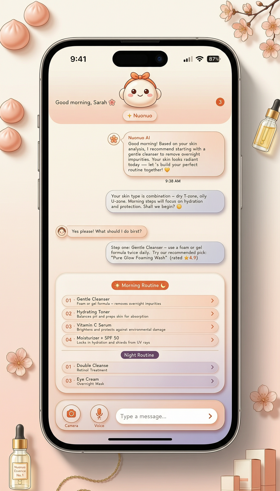
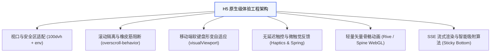

# 小糯智肤 H5 移动端 UI/UX 设计与原生体验对标规范

本文档定义小糯智肤（nuonuo-agent）在 H5 形态下的界面设计语言、交互规范、原生级体验工程对标方案以及组件落地标准，作为产品体验设计与前端工程实施的技术基线。

---

## 1. 背景定位与设计哲学

### 1.1 形态选择与原生体验对标
为兼顾传播裂变速度、微信生态互联以及免安装即开即用的低门槛特性，小糯智肤在当前阶段确立采用移动端 H5 作为主交付形态。
传统 H5 应用普遍存在视口晃动、滚动穿透、点击迟滞以及加载白屏等“网页机械感”。本项目明确将体验对标基线锁定在 **iOS / Android 原生 App** 的细腻质感与物理拟真度，通过现代 Web 标准与容器层工程治理，全面抹平 H5 与原生应用的体验鸿沟。

### 1.2 核心设计哲学
1. **老友式温软陪伴**：
   界面整体去除冷硬的医疗诊断感与严肃的系统表单感，采用白桃雪媚娘的温润奶白与柔粉质感，营造出让人心安、放松的倾诉空间。
2. **零压迫与零填表**：
   页面放弃繁琐的 Tab 分页、九宫格货架和强制问卷，以单页流式对话为中枢，所有信息沉淀均在自然随聊与拍照中完成。
3. **确定性与安全透明**：
   涉及成分安全时，视觉呈现清晰严谨、结论一目了然；记忆沉淀全程透明，赋予用户最高级别的知情权与控制权。

### 1.3 移动端界面原型总览
基于 302.AI 专业视觉模型（Wan 2.7 Image）生成的原生级高保真概念原型设计如下：



---

## 2. 原生体验对标与 H5 容器级工程破局

为消除移动端 Web 容器的割裂感，系统在前端底层建立六项关键技术治理机制：



### 2.1 视口与全面屏安全区适配方案
在移动端浏览器（特别是 iOS Safari 与微信 Webview）中，上下滑动会导致浏览器地址栏与底部操作栏动态收起或展开。传统使用 `100vh` 会引起页面高度动态抖动，导致底部输入栏被遮挡或拉扯。

- **规范要求**：
  1. 根容器高度统一使用动态视口单位 `100dvh`（Dynamic Viewport Height），在不支持的环境下平滑回退至 CSS 变量 `--app-height`（由 JavaScript `window.innerHeight` 初始化计算）；
  2. 页面 `viewport` 严格声明 `viewport-fit=cover`；
  3. 顶栏导航与底部悬浮操作栏严格注入系统安全区内边距：
     - 顶部填充：`padding-top: max(12px, env(safe-area-inset-top));`
     - 底部填充：`padding-bottom: max(16px, env(safe-area-inset-bottom));`
  4. 顶栏背景采用 `backdrop-filter: blur(20px)` 毛玻璃效果，背景色彩与系统状态栏反色浸润，营造原生 App 沉浸通透感。

### 2.2 滚动隔离与橡皮筋回弹阻断
移动端默认的页面滚动具有“边缘橡皮筋（Over-scroll Bounce）”特性，下拉时容易漏出浏览器底色，破坏原生沉浸感。

- **规范要求**：
  1. 根节点（`html`、`body`、`#app`）强制实施视口固定：
     ```css
     html, body {
         position: fixed;
         width: 100%;
         height: 100%;
         overflow: hidden;
         overscroll-behavior-y: none;
         -webkit-touch-callout: none;
         -webkit-user-select: none;
         user-select: none;
     }
     ```
  2. 对话流区域作为独立的局部滚动容器，启用硬件加速与弹性平滑滚动：
     ```css
     .chat-scroll-container {
         height: 100%;
         overflow-y: auto;
         overflow-x: hidden;
         -webkit-overflow-scrolling: touch;
         overscroll-behavior-y: contain;
         transform: translateZ(0);
         will-change: scroll-position;
     }
     ```

### 2.3 移动端软键盘弹起与视口形变治理
当用户点击文本输入框时，移动端软键盘瞬间升起，会导致页面可视高度被压缩，引起头部骨骼动画被挤压变形；键盘收起后，iOS 易出现底部留白死区。

- **规范要求**：
  1. 监听 `window.visualViewport` 的 `resize` 与 `scroll` 事件，实时获取当前实际可视区域高度及偏移量；
  2. 底部输入栏不采用容易产生跳变的 `position: fixed` 方案，改用 CSS `transform: translateY(...)` 动态贴合键盘顶部；
  3. 输入栏触发失焦（`blur`）时，强制调度平滑滚动微调，重置视口位置：
     ```javascript
     inputElement.addEventListener('blur', () => {
         window.scrollTo({ top: 0, left: 0, behavior: 'smooth' });
     });
     ```
  4. 键盘弹出期间，小糯顶部动态形象区自动缩放为微缩徽标模式（由 120px 等比缩小至 44px），释放空间优先保证会话正文的可读性。

### 2.4 原生级触控响应与物理震感反馈
传统网页点击存在 300ms 延迟，且按钮缺乏原生交互的触觉感知。

- **规范要求**：
  1. 全局配置 `touch-action: manipulation;`，彻底移除双击缩放判断引入的 300ms 点击延迟；
  2. 禁用移动端原生点击高亮蓝色阴影：`-webkit-tap-highlight-color: transparent;`；
  3. 关键可交互组件（拍照按钮、早晚流程便签、记忆卡片）统一配置原生弹簧微交互反馈：
     ```css
     .interactive-btn:active {
         transform: scale(0.96);
         transition: transform 100ms cubic-bezier(0.2, 0.8, 0.2, 1);
     }
     ```
  4. 引入 Web Vibration API，为核心操作赋予物理振动触感（设备支持时）：
     - 轻触拍照/发语音：触发 10ms 微弱敲击触感；
     - 识别出成分冲突/风险警告：触发 `[15ms, 40ms, 15ms]` 双脉冲警示触感。

### 2.5 小糯骨骼动画轻量化渲染方案
小糯作为白桃雪媚娘拟人形象，具备呼吸、微动、心疼、警惕摆手、开心转圈等动态反馈。采用传统 GIF 或 MP4 视频会导致资源包庞大且切换卡顿。

- **规范要求**：
  1. 采用矢量骨骼动画引擎（推荐 Rive Web Runtime 或 Spine 2D WebGL 运行时）；
  2. 核心骨骼资源控制在 250KB 以内，矢量无损缩放，支持 60fps ~ 120fps 高刷屏硬件加速；
  3. 情绪状态机与后端 SSE 下发的 `event: emotion`（如 `CONCERNED`、`WARNED`、`HAPPY`）建立绑定，通过状态机过渡参数（Transition Duration 250ms）实现无缝、平滑的骨骼插值过渡，消除跳帧现象。

### 2.6 SSE 打字机流式渲染与智能吸附滚动算法
服务端下发 SSE 数据流时，打字机字符高频逐字浮现。若直接每字触发 `scrollToBottom`，用户在向上翻看历史消息时会被强行拉回底部。

- **规范要求**：
  1. 建立**双向阈值智能吸附滚动判定**：
     - 计算当前滚动距离底部的高度：`distanceToBottom = scrollHeight - scrollTop - clientHeight`；
     - 当 `distanceToBottom <= 80px`（用户处于底部），新字下发时自动调用 `scrollTo({ top: scrollHeight, behavior: 'instant' })` 实现平滑视口跟随；
     - 当 `distanceToBottom > 80px`（用户正在向上翻阅历史），立即挂起自动滚动，在屏幕右下角浮现“收到新消息 ↓”轻提示药丸胶囊，点击该胶囊方才平滑滚回底部。

---

## 3. 四大核心功能区块 UI/UX 深度规范

界面整体划分为 4 个高度集成的结构区块：

```
┌────────────────────────────────────────────────────────┐
│  [⚙️ 小糯记住了我]         小糯智肤 (Nuonuo)            │
├────────────────────────────────────────────────────────┤
│                                                        │
│       ( ◕‿◕ )  【1. 小糯动态 IP 形象区】               │
│      / 🌸  \   • 情绪骨骼动画: 呼吸 / 心疼 / 警惕 / 欢喜│
│      "宝子，今天脸蛋摸起来舒服一点了吗？"                │
│                                                        │
├────────────────────────────────────────────────────────┤
│  【2. 会话流与步骤卡片区】                             │
│  • SSE 流式打字推流，白桃暖粉气泡                      │
│  • 晨晚护肤便签卡片 (Morning/Night Routine)            │
│  • 四层配伍禁忌排雷警示条                              │
├────────────────────────────────────────────────────────┤
│  【3. 多模态即时操作栏 (悬浮 Dock)】                   │
│  [ 📷 拍照识别 ]     [ 🎙️ 按住说话 ]    [ 💬 聊聊... ] │
└────────────────────────────────────────────────────────┘
                     ▲ 右上角滑出
┌────────────────────────────────────────────────────────┐
│  【4. “小糯记住了我”记忆中心 (右侧抽屉)】              │
│  • 透明卡片列表: 肤质基线 / 成分禁忌 / 使用偏好         │
│  • 支持单条向左滑动删除与纠偏                          │
└────────────────────────────────────────────────────────┘
```

### 3.1 区块 1：小糯动态 IP 形象区
- **视觉层级**：常态位于屏幕顶部三分之一黄金分割区域，居中展示。
- **外观参数**：
  - 角色形象：半透明乳白圆润雪媚娘体，粉嫩珊瑚绒发带，双颊带蜜桃晕染；
  - 尺寸规格：常态尺寸 110dp × 110dp；键盘升起时缩放至 44dp × 44dp 并吸附于顶栏左侧。
- **状态机与动画表现**：
  | 情绪状态 | 视觉与动作表现 | 触发场景 |
  | :--- | :--- | :--- |
  | **NORMAL (元气常态)** | 微微上下呼吸浮动，发带轻摆，嘴角甜甜含笑 | 默认就绪态、日常问候 |
  | **CONCERNED (关切心疼)** | 脸颊浮现淡粉红光芒，两只小手抬起轻抚面颊，眼神温柔关切 | 识别出自拍皮肤急性泛红、脱屑、刺痛 |
  | **ALERT (警惕摆手)** | 两只肉乎乎小短手急切左右摆动，头部微微侧偏 | 命中成分配伍禁忌冲突（如酸类+A醇） |
  | **CELEBRATE (开心欢喜)** | 身体轻盈旋转半圈，头顶冒出半透明露珠水泡与粉色花瓣特效 | 用户反馈皮肤好转、舒缓成功 |
- **交互微细节**：用户用手指轻戳小糯身体时，小糯身体呈现果冻般的物理弹性形变（Squash and Stretch），并触发随机一句暖心语音或短气泡（如“在呢在呢，小糯一直在~”）。

### 3.2 区块 2：会话流与步骤卡片区
- **会话气泡**：
  - 用户气泡：右对齐，背景采用温润暖灰粉（`#F7ECE8`），圆角 `18px 18px 4px 18px`；
  - 小糯气泡：左对齐，背景采用纯白高透卡片（`#FFFFFF`，带轻微弥散阴影 `0 4px 20px rgba(220,160,150,0.08)`），圆角 `18px 18px 18px 4px`；
  - 行距与排版：正文字号 15pt，行高 1.6，段落间距 10pt，杜绝大段无换行密排文字。
- **晨晚极简步骤便签卡片（Routine Card）**：
  当后端识别到需要给出具体护肤方案时，下发 `card` 事件，前端渲染为白桃便签式折叠卡片：
  - 卡片顶部包含“早间晨曦（AM）”与“晚间修护（PM）”分段切换标签；
  - 步骤采用清晰递进数字标识（Step 1、Step 2、Step 3），单步限制在一行核心动作加一行浅灰避坑备注；
  - 卡片底部设有“一键复制便签”与“设为当前执行方案”便捷操作。
- **四层配伍禁忌排雷警示卡（Grounding Warning Card）**：
  若命中成分配伍禁忌，在对话流中单独插入警示卡片：
  - 严禁同用（P0/P1）：珊瑚红暖底（`#FFF2F0`），边框 `#FFCCC7`，以温和但清晰的口吻标明冲突成分与化学水解机理；
  - 谨慎搭配（P2）：杏黄暖底（`#FFFBE6`），提示早晚错开或耳后建立耐受。

### 3.3 区块 3：多模态即时操作栏（悬浮 Dock）
- **形态特征**：采用悬浮岛（Floating Island）设计，距离屏幕左右边距 16px，底部悬浮于安全区之上，具备 `backdrop-filter: blur(24px)` 的半透明高质感亚克力质感。
- **三大核心交互构件**：
  1. **左侧相机按钮（多模态入口）**：
     - 点击呼出原生风格底部 ActionSheet 选项面板：
       - `拍照测肤`：调起前置摄像头，带有面部椭圆对齐辅助虚线框与柔光补光提示；
       - `拍成分表/梳妆台`：调起后置摄像头，带有矩形文字取景对焦框与清晰度预检；
       - `从相册选取`：系统相册选择已有图片。
  2. **中间语音录入按钮（按住说话）**：
     - 默认状态为圆润胶囊形态，支持一键切换为打字输入框；
     - 按住（TouchStart）时，屏幕中央浮现磨砂半透明水波纹动态声浪扩散动效，录音时长实时提示；
     - 上滑至指定区域即时取消发送，松手自动上传并转写。
  3. **右侧发送与快捷拓展按钮**：
     - 文本框激活输入时，相机与语音平滑收拢，发送按钮变为白桃红亮色渐变态；
     - 空白状态下展示快捷灵感微标签（如“看成分冲突”、“测脸颊泛红”）。

### 3.4 区块 4：“小糯记住了我”记忆中心（抽屉式设计）
- **唤起逻辑**：点击顶栏右上角“小糯记住了我（带小书签图标）”，右侧无缝滑出全屏抽屉（占屏幕宽度 88%），主界面叠加 40% 不透明度的高斯模糊遮罩层。
- **记忆分类卡片**：
  - **肤质基线（Skin Base）**：例如“中性偏干”、“角质层薄弱”、“屏障受损恢复期”；
  - **成分禁忌（Allergies & Conflicts）**：例如“酒精严重接触性泛红”、“不耐受 0.1% 视黄醇”；
  - **使用偏好（Preferences）**：例如“喜欢清爽水感乳液”、“排斥油润封闭面霜”。
- **单条记忆掌控权交互**：
  - 用户可点击任意一条卡片进行修改纠偏；
  - 支持类似 iOS 原生列表的“向左轻扫（Swipe to Delete）”，露出红色删除按钮，点击后带物理淡出缩起动画；
  - 底部提供“彻底清空小糯的全部记忆”兜底选项，并二次确认，保障隐私自主权。

---

## 4. 三大高频业务场景全链路交互走查

### 4.1 场景一：开箱/逛街随手拍瓶身排雷
```
[点击操作栏相机] 
       ↓ 
[选择“拍成分表”] 
       ↓ 
[调起后置镜头对准瓶身包装拍摄] 
       ↓ 
[图片瞬间以缩略图形式滑入对话流，附带闪烁扫描波纹特效] 
       ↓ 
[小糯 IP 切换为“警惕摆手”骨骼状态] 
       ↓ 
[SSE 下发成分冲突提示与排雷便签] 
       ↓ 
[排雷结论：高浓度果酸与蓝铜胜肽冲突，温和建议错开早晚使用]
```

### 4.2 场景二：洗完脸自拍看好转进展
```
[点击操作栏相机] 
       ↓ 
[选择“拍照测肤”] 
       ↓ 
[前置摄像头引导：自然光、素颜、平视对准椭圆框] 
       ↓ 
[自拍上传，小糯后台调取上周历史记忆进行多模态对比] 
       ↓ 
[小糯 IP 触发“开心转圈”动画，头顶冒出水水泡泡与花瓣] 
       ↓ 
[SSE 推送温软鼓励话术：“宝子你看！两颊红血丝明显淡了一大半，屏障在变坚强啦！”] 
       ↓ 
[生成接下来的 3 天温和维稳便签卡片]
```

### 4.3 场景三：深夜加班熬夜护肤咨询
```
[用户文字输入：“加班到深夜，明天脸肯定又黄又垮，救救我”] 
       ↓ 
[系统检测到当前为深夜时段 (00:00 ~ 05:00)] 
       ↓ 
[前端页面微调为夜间温和低照度模式，小糯怀抱温水杯微微点头] 
       ↓ 
[调取该用户“排斥厚重油霜”画像标签] 
       ↓ 
[先给予情绪抚慰，随后输出 2 步极简睡前修护便签，叮嘱早点钻被窝]
```

---

## 5. 视觉设计系统与组件规范 (Design System Tokens)

### 5.1 色彩体系 (Color Tokens)
| 语义代号 | 颜色值 (HEX) | 视觉用途 | 设计依据 |
| :--- | :--- | :--- | :--- |
| **`nuonuo-peach-primary`** | `#FF8A80` | 核心品牌主色、主操作按钮渐变起始、小糯腮红 | 白桃雪媚娘特有的粉润元气质感 |
| **`nuonuo-peach-light`** | `#FFF0ED` | 用户消息气泡背景、选中状态高亮浅底 | 柔和不刺眼，长时间凝视无视觉疲劳 |
| **`nuonuo-cream-bg`** | `#FAF7F5` | 全局页面主底色、抽屉背景底色 | 细腻乳白奶霜色调，消除冷白底色的机械感 |
| **`nuonuo-surface-card`** | `#FFFFFF` | 卡片容器、小糯对话气泡、操作 Dock 底色 | 纯白承载内容，强化可读性与层次反差 |
| **`nuonuo-text-main`** | `#2B2523` | 正文一级文本、标题 | 带有轻微暖调的深棕黑，比纯黑更具亲和力 |
| **`nuonuo-text-sub`** | `#8F8581` | 二级说明文本、时间戳、未激活提示 | 柔和暖灰，提供清晰信息阶梯 |
| **`nuonuo-safe-green`** | `#52C41A` | 成分安全标、耐受建立达标状态 | 国际公认健康与安心语义 |
| **`nuonuo-caution-orange`** | `#FA8C16` | 谨慎搭配、建立耐受中提醒 | 温暖警示，不引发心理恐慌 |
| **`nuonuo-danger-red`** | `#FF4D4F` | 严禁配伍冲突、过敏源高危阻断 | 明确底线红线，保障物理级安全 |

### 5.2 字体排版层级 (Typography Tokens)
采用系统原生默认字体栈（iOS 优先调用 `-apple-system, BlinkMacSystemFont, 'SF Pro Display'`，Android 优先调用 `'PingFang SC', 'Roboto', 'Noto Sans SC'`）：

| 阶梯层级 | 字号 (pt/px) | 字重 (Weight) | 行高 (Line Height) | 应用场景 |
| :--- | :--- | :--- | :--- | :--- |
| **Title L** | 20px | 600 (Semibold) | 28px | 抽屉标题、大卡片主标题 |
| **Title M** | 17px | 600 (Semibold) | 24px | 顶栏标题、便签卡片分类头 |
| **Body M (正文)** | 15px | 400 (Regular) | 24px | 会话气泡正文、小糯抚慰话术 |
| **Caption S** | 13px | 400 (Regular) | 18px | 护肤步骤避坑备注、属性标签 |
| **Micro XS** | 11px | 500 (Medium) | 14px | 时间戳、徽标角标、辅助说明 |

### 5.3 圆角与空间间距 (Border Radius & Spacing)
- **网格基准**：严格遵循 4px / 8px 网格对齐；
- **圆角规范**：
  - 核心会话气泡：`18px`；
  - 护肤便签大卡片：`20px`；
  - 悬浮操作 Dock：`28px`（完全圆角胶囊形态）；
  - 标签与微徽章：`8px`。
- **微阴影体系**：
  - 悬浮卡片柔和弥散阴影：`box-shadow: 0 8px 32px rgba(220, 160, 150, 0.12);`；
  - 浮动 Dock 深度阴影：`box-shadow: 0 12px 40px rgba(0, 0, 0, 0.08);`。

### 5.4 动效参数规范 (Motion Tokens)
- **弹簧物理曲线**：
  `cubic-bezier(0.34, 1.56, 0.64, 1)`（典型 iOS Spring 弹簧动效，用于弹窗、抽屉弹出与按钮回弹）；
- **平滑淡入曲线**：
  `cubic-bezier(0.2, 0.8, 0.2, 1)`，持续时间 `200ms`；
- **打字机推进节奏**：
  单字符渲染间隔锁定在 `25ms ~ 35ms`，模拟真人温和打字律动。

---

## 6. Web 性能指标与工程验收门禁

为确保在任意主流移动端网络与机型上均具备原生流畅度，建立以下交付验收门禁：

| 评估指标 | 目标基线 | 极端网络/低端机兜底 | 治理手段 |
| :--- | :--- | :--- | :--- |
| **FCP (首次内容绘制)** | $\le 500\text{ms}$ | $\le 800\text{ms}$ | 关键 CSS 内联、首屏骨架屏直接直出、去非必要外链字体 |
| **TTFT (SSE 首字下发)** | $\le 800\text{ms}$ | $\le 1200\text{ms}$ | 快轨 AC 自动机本地预查、服务端 SSE 零缓冲直接推流 |
| **交互帧率 (FPS)** | $\ge 58\text{fps}$ (60Hz 屏)<br/>$\ge 110\text{fps}$ (120Hz 屏) | $\ge 50\text{fps}$ | 动效完全收敛至 `transform` 与 `opacity`，启用 GPU 合成层 |
| **INP (交互响应延迟)** | $\le 80\text{ms}$ | $\le 120\text{ms}$ | 移除 300ms 延迟，密集计算转入 Web Worker 或旁路异步 |
| **资源总包体 (Gzip)** | 首屏 JS $\le 180\text{KB}$<br/>骨骼动画 $\le 250\text{KB}$ | 首屏总包 $\le 500\text{KB}$ | Tree-shaking 剔除冗余依赖，骨骼动画按需异步分包加载 |

---

## 7. 结语与后续演进

小糯智肤通过视口动态隔离、硬件级滚动穿透阻断、矢量骨骼动态驱动与智能吸附流式算法，彻底摆脱了传统 H5 的粗糙网页感。在保证轻量跨平台分发优势的同时，为关注皮肤健康与科学配方的用户提供了一款如老友般温润贴心、丝滑稳定的原生级 AI 智肤助手。
